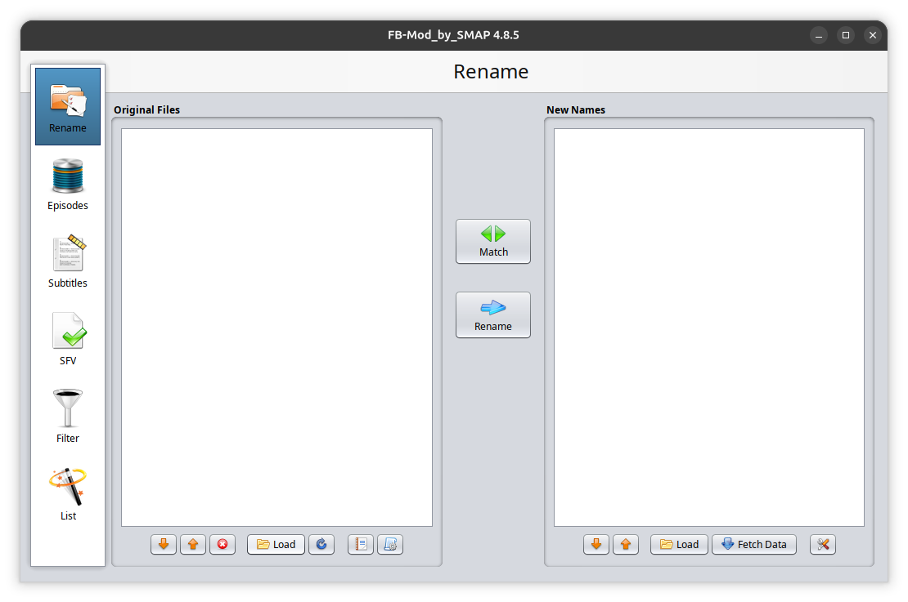
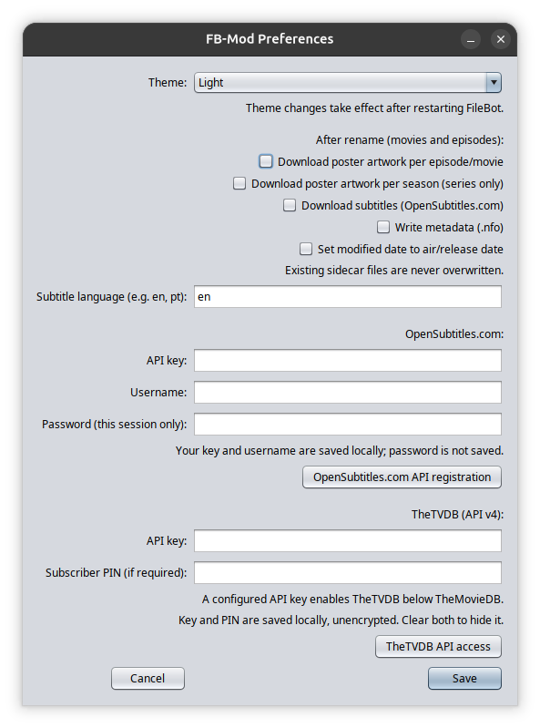

# FB Mod

## Downloads and builds

Download **FB-Mod_by_SMAP 4.8.5** from the
[GitHub release](https://github.com/SMAP-git/FB-Mod/releases/tag/v4.8.5-smap).

| Platform | Build script | Package |
| --- | --- | --- |
| Debian / Ubuntu x86_64 | [`build-deb.sh`](build-deb.sh) (`./build-deb.sh`) | [FB-Mod_by_SMAP_4.8.5_amd64.deb](https://github.com/SMAP-git/FB-Mod/releases/download/v4.8.5-smap/FB-Mod_by_SMAP_4.8.5_amd64.deb) |
| Windows x64 portable | [`build-windows-portable.sh`](build-windows-portable.sh) (`./build-windows-portable.sh`) | [FB-Mod_by_SMAP_4.8.5-portable.zip](https://github.com/SMAP-git/FB-Mod/releases/download/v4.8.5-smap/FB-Mod_by_SMAP_4.8.5-portable.zip) |
| Linux x86_64 portable | [`build-linux-portable.sh`](build-linux-portable.sh) (`bash build-linux-portable.sh`) | [FB-Mod_by_SMAP_4.8.5-linux-x86_64-portable.tar.xz](https://github.com/SMAP-git/FB-Mod/releases/download/v4.8.5-smap/FB-Mod_by_SMAP_4.8.5-linux-x86_64-portable.tar.xz) |

All three packages bundle Java and JavaFX. Portable packages keep settings beside
the application; extract them into a writable folder.

* **Debian / Ubuntu:** install the `.deb` with your package manager. Archive
  extraction requires `7zip` or `p7zip-full`.
* **Windows:** extract the entire ZIP and run `filebot.launcher.exe`. Archive
  extraction requires Windows 7-Zip. This package uses Java/JavaFX 11.0.2 and
  has not been execution-tested on Windows.
* **Linux portable:** extract the archive and run `./filebot.sh` inside its
  application folder. This release requires glibc 2.42+, GTK 3, X11/XWayland,
  and zlib. It includes standalone 7-Zip and rebuilt MediaInfo libraries.

Verify downloads with the release's
[SHA256SUMS](https://github.com/SMAP-git/FB-Mod/releases/download/v4.8.5-smap/SHA256SUMS).
See [COMPILING.md](COMPILING.md) for build requirements and instructions.

TheTVDB API v4 credentials can be overridden with the JVM properties
`-Dnet.filebot.WebServices.TheTVDB.apikey=...` and, if required, `-Dnet.filebot.WebServices.TheTVDB.pin=...`.

## Docker and Unraid

Build the Debian package, then run `bash packaging/docker/build-docker.sh` to
create `fb-mod:4.8.5`. It provides a TigerVNC desktop on port `5902` and a noVNC
browser WebUI on port `6081`, with persistent settings in `/config` and media in
`/media`. See the [Docker guide](packaging/docker/README.md) and
[Unraid template](packaging/docker/unraid-template.xml) for setup and image
transfer instructions. The registry image is `ghcr.io/smap-git/fb-mod:4.8.5`;
a loadable Docker archive is also available in the
[release](https://github.com/SMAP-git/FB-Mod/releases/tag/v4.8.5-smap).
VNC passwords are optional: leave `VNC_PASSWORD` empty for passwordless access.
Anyone who can reach either port can control the app without a password;
keep both ports on a trusted network.

## Screenshots

### Rename window

FB-Mod_by_SMAP 4.8.5 with the Original Files and New Names panels.

### Preferences

Theme selection, optional after-rename actions, and provider credentials.

## Preferences and after-rename actions

TheMovieDB, TVmaze, AniDB and TheTVDB episode matching searches the series title before explicit episode
markers such as `S01E07` and `1x07`, ignoring episode titles and release suffixes.
Keep episode numbers in filenames: they are used to select the actual episode.
Clear filename-derived queries bypass the legacy series-name index. Files without
recognizable markers still use the existing folder/name detection and manual
prompt; ambiguous series results still require confirmation. Shift/Alt continues
to force manual identification.
AniDB also accepts absolute episode filenames such as
`[Group] Show Name - 07 [1080p].mkv`. Movie mode already cleans release information
before searching TMDb / OMDb. Music mode uses AcoustID audio fingerprints or
embedded ID3 tags rather than searching a filename.

Movie Mode queries TMDb / OMDb directly for clear title/year filenames, such as
`movie.2026.1080p.WEBRip.mp4`, before consulting the legacy movie index.
Release suffixes are excluded from the query. A unique result fills New Names
without the intermediate title-entry dialog; ambiguous results still use the
selection dialog. Unrecognized filenames and empty search results retain the
existing detection/manual fallback. Shift/Alt still forces manual identification.

Standard episode/movie names automatically append the subtitle language in
English when it is tagged in the source filename: `_track3_[eng].srt` becomes
`<matched-video-name>.English.srt`, `[fra]` becomes `.French.srt`, etc.
Bracketed tags, two-/three-letter ISO codes, bibliographic aliases (e.g. `fre`,
`ger`), and existing `.en` / `.English` suffixes are recognized. Supported
regional tags such as `[pt-BR]` retain their distinct language name.
Videos and subtitles without recognized tags keep their usual names; no content
detection or network lookup is used for automatic suffixes. Custom formats are
unchanged; use `{lang.name}` in a custom subtitle format to include the full
language name explicitly.
Edit Format includes clickable full-language-name examples for episodes and
movies, plus an episode `{subt}` example for language codes (`.eng`, `.fre`)
and optional subtitle categories. Select a tagged subtitle with **Change Sample**
to preview these suffixes; the built-in metadata sample has no subtitle file.

Open **Rename > Settings (gear) > Preferences...** or the gear button in
**Subtitles**.

* Choose **System**, **Light**, or **Dark** theme. Restart FileBot to apply it.
  Dark-theme action menus use a dark background and high-contrast light-blue
  links so settings and provider options remain readable.
  Linux application launchers disable desktop startup notifications to avoid a
  lingering busy pointer after the Java window is already usable. This does not
  change application loading time or in-app progress indicators.
  Rename notifications use explicit black text on their white background in
  every theme, including dark system themes.
* After-rename actions are opt-in and disabled by default. They run only for
  successfully renamed movies/episodes, not unmatched files or music.
* Artwork writes `<video-name>-poster.jpg`. Metadata writes `<video-name>.nfo`
  containing the matched title, year or episode numbers, date, and known IDs.
  Existing extended-attribute metadata behaviour is unchanged.
* Subtitles write `<video-name>.<language>.srt`. Hash matches are preferred;
  otherwise results use the matched movie ID or series/season/episode and
  provider download ranking. Review name-based matches if release timing differs.
* Existing poster, NFO, and subtitle files are preserved. Downloads use temporary
  files so failed downloads do not leave partial sidecars.
* **Set modified date** changes the video's modification time to its air/release
  date at midnight in the local timezone; it does not change filesystem creation
  dates. Missing dates are reported rather than guessed. With hardlinks or
  symlinks, changing the modified date also changes the linked source file's date.
* Failures are logged and reported separately; a successful rename is not undone.

## TheTVDB

Enter your own **API v4 key** in the TheTVDB section of Preferences.
Enter a **subscriber PIN** only if your key/account requires it; PIN alone is
not sufficient. See <https://thetvdb.com/api-information> for access options.
Saving a key shows TheTVDB directly below TheMovieDB in Episode Mode the next
time you open the menu, without restarting. Clearing the key and PIN hides it.
Saving changed credentials resets authentication so subsequent API requests use
the new key/PIN.

The key and PIN are stored in local Java preferences **unencrypted**, like the
OpenSubtitles.com API key. Do not share preferences backups. The JVM overrides
listed above take precedence over saved values and keep the provider visible
while a nonempty override key is set. Menu visibility indicates configuration,
not successful validation: an invalid key or PIN still produces an API error.
Some auxiliary TheTVDB artwork/lookup methods still use its legacy API; series
search and episode-list retrieval use v4.

## OpenSubtitles.com

REST search, hash lookup, and subtitle downloads are available in **Subtitles**.
Register your own API key at <https://www.opensubtitles.com/en/consumers> and
enter it in Preferences. Downloads also require your OpenSubtitles.com username
and password and are subject to the service's quota/account rules.

The API key and username are saved in your local Java preferences (not encrypted).
The password is kept only for the current session: re-enter it after restarting.
Do not share preferences backups containing your key. The API key can alternatively
be supplied with `-Dnet.filebot.OpenSubtitles.apiKey=...`.
For command-line use, credentials can be supplied through
`OPENSUBTITLES_API_KEY`, `OPENSUBTITLES_USERNAME`, and `OPENSUBTITLES_PASSWORD`
environment variables instead of preferences or command-line arguments.

The old OpenSubtitles.org client and upload workflow remain available.
OpenSubtitles.com upload support is not implemented.
